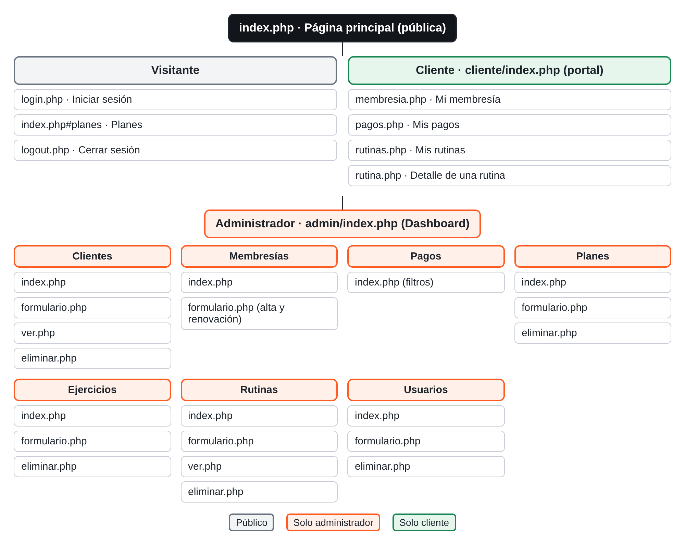
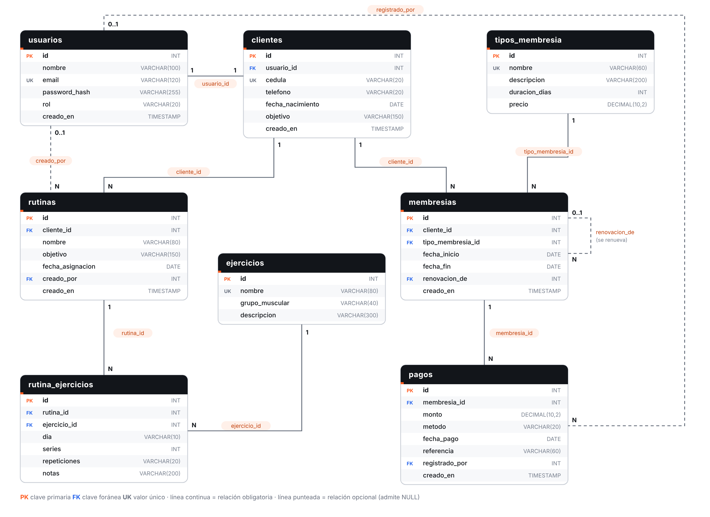

# Tony Performance Center Web

Proyecto Final Integrador · **Programación V** · UACA
**Entregable 2 — Avance del código**

Aplicación web en **PHP + MySQL** para administrar un gimnasio: clientes, planes de
membresía, membresías (con renovaciones), pagos, ejercicios, rutinas y usuarios. Incluye un
**portal del cliente** donde cada persona consulta únicamente su propia membresía,
sus pagos y sus rutinas.

> **Estudiante:** Oscar Armando Herrera Azofeifa (carné 25112950) · trabajo individual
> **Docente:** Ana Salas Elizondo
> **Repositorio:** https://github.com/oaherrea/tony-performance-web

---

## 1. Palabras clave (máx. 5)

`gimnasio` · `membresías` · `rutinas` · `PHP-MySQL` · `seguridad web`

## 2. Objetivos

**General.** Desarrollar un sistema web que permita a un gimnasio controlar sus clientes,
el vencimiento de sus membresías, sus pagos y la asignación de rutinas, reemplazando el
control manual.

**Específicos**

1. Diseñar una base de datos relacional (usuarios, clientes, tipos de membresía,
   membresías, pagos, ejercicios y rutinas) con llaves primarias, foráneas y relaciones.
2. Implementar el CRUD de clientes, planes de membresía, ejercicios y usuarios para el administrador.
3. Calcular automáticamente el período de cada membresía y su estado (programada, activa o
   vencida), registrando cada renovación junto con su pago.
4. Registrar los pagos (efectivo, tarjeta, SINPE o transferencia) y mostrar su historial.
5. Permitir que cada cliente inicie sesión y **consulte sus propias rutinas**, su membresía
   y sus pagos, sin acceso a datos de otras personas.
6. Proteger el sistema con contraseñas cifradas con *hash* y control de acceso por rol.

## 3. Tecnologías (las vistas en clase)

| Tecnología | Uso |
|---|---|
| HTML5 + CSS | Estructura y estilos (`css/estilos.css`) |
| Bootstrap 5 (CDN) | Diseño responsive, tablas, formularios, menú |
| JavaScript básico | Confirmar eliminaciones y calcular fechas en el formulario (`js/eventos.js`) |
| PHP (procedural) | Lógica, sesiones (`$_SESSION`), formularios (`$_POST`/`$_GET`), `include` |
| MySQL + PDO | Consultas preparadas (`prepare` / `execute` / `fetch`) |
| Git y GitHub | Control de versiones y evidencia de commits |

La organización (`config.php`, `conexion.php`, `includes/header.php` y `footer.php`, `css/`, `js/`,
`datos/`) sigue el proyecto **TechBooks** visto en clase.

## 4. Instalación (XAMPP)

Requisitos: PHP 8.1 o superior y MySQL/MariaDB. Bootstrap se carga por CDN (igual que en
TechBooks), por lo que se necesita internet para ver los estilos.

1. Copie la carpeta del proyecto a `C:\xampp\htdocs\tony-performance-web`.
2. Abra el panel de XAMPP e inicie **Apache** y **MySQL**.
3. Abra **phpMyAdmin** (`http://localhost/phpmyadmin`) → pestaña **Importar** y cargue el
   archivo **`database.sql`** (crea la base `tony_performance_web`, sus tablas y los datos de ejemplo).
4. Abra `http://localhost/tony-performance-web/`.

Si su MySQL tiene otra contraseña para `root`, cámbiela en `conexion.php`.

### Usuarios de prueba

| Rol | Correo | Contraseña |
|---|---|---|
| Administrador | `admin@tonyperformance.com` | `Admin123!` |
| Cliente | `cliente@tonyperformance.com` | `Cliente123!` |
| Otros clientes | `valery@`, `josechacon@`, `josearaya@`, `liam@tonyperformance.com` | `Cliente123!` |

Las fechas de los datos de ejemplo son relativas al día de hoy, así siempre hay membresías
activas, por vencer y vencidas para probar.

## 5. Estructura del proyecto

```
tony-performance-web/
├── index.php                 Página principal pública (planes leídos de la BD)
├── login.php                 Inicio de sesión
├── logout.php                Cierre de sesión
├── config.php                Inicia la sesión y define la zona horaria
├── conexion.php              Conexión a MySQL con PDO ($pdo)
├── database.sql              Estructura de la BD + datos de ejemplo
├── datos/planes.php          Consulta de los planes (como datos/libros.php en TechBooks)
├── includes/
│   ├── header.php            Cabecera y menú (cambia según el rol)
│   ├── footer.php            Pie de página y scripts
│   ├── funciones.php         Fechas, estados de membresía y formatos
│   ├── soloAdmin.php         Protege las páginas del administrador
│   ├── soloCliente.php       Protege el portal del cliente
│   └── detalleRutina.php     Muestra una rutina por días (admin y cliente)
├── css/estilos.css           Estilos propios
├── js/eventos.js             Confirmaciones y cálculo de fechas en el formulario
├── admin/                    Módulos del administrador
│   ├── index.php             Dashboard
│   ├── clientes/             index, formulario, ver, eliminar
│   ├── usuarios/             index, formulario, eliminar
│   ├── tipos/                Planes de membresía: index, formulario, eliminar
│   ├── membresias/           index, formulario (alta y renovación + pago)
│   ├── pagos/                index (historial con filtros)
│   ├── ejercicios/           index, formulario, eliminar
│   └── rutinas/              index, formulario, ver, eliminar
├── cliente/                  Portal del cliente: index, membresia, pagos, rutinas, rutina
└── docs/                     Diagrama ER, mapa del sitio, plan de pruebas y capturas
```

## 6. Mapa del sitio y navegación



La defensa empieza en la **página principal** (`index.php`): un visitante ve los planes y el
botón *Iniciar sesión*. Según el rol, el login lleva al dashboard del administrador o al
portal del cliente. Cada menú muestra solo lo que ese rol puede usar.

## 7. Modelo de datos



Diagrama en [`docs/diagrama_er.png`](docs/diagrama_er.png) (vectorial: [`docs/diagrama_er.svg`](docs/diagrama_er.svg)).

| Tabla | Propósito | Relaciones |
|---|---|---|
| `usuarios` | Cuentas de acceso (rol `administrador` o `cliente`) con `password_hash` | 1:1 con `clientes` |
| `clientes` | Datos personales del cliente | pertenece a un usuario |
| `tipos_membresia` | Planes: nombre, duración en días, precio | 1:N con `membresias` |
| `membresias` | Período contratado por un cliente | N:1 cliente, N:1 plan, `renovacion_de` apunta a la membresía anterior |
| `pagos` | Cobro de cada membresía | N:1 membresía; `registrado_por` → usuarios |
| `ejercicios` | Catálogo por grupo muscular | N:M con rutinas |
| `rutinas` | Plan asignado a un cliente | N:1 cliente |
| `rutina_ejercicios` | Tabla intermedia: día, series, repeticiones | une rutinas y ejercicios |

Se usan llaves foráneas con `ON DELETE CASCADE` (al borrar un cliente se borran sus
membresías, pagos y rutinas), `SET NULL` (para saber quién cobró) y sin cascada donde
no debe permitirse (no se borra un plan ya vendido ni un ejercicio usado en una rutina).

## 8. Descripción de los módulos

| Módulo | Archivos | Qué hace |
|---|---|---|
| Página principal | `index.php`, `datos/planes.php` | Presenta el gimnasio y lista los planes desde la BD (acceso público) |
| Autenticación | `login.php`, `logout.php`, `includes/solo*.php` | Valida correo y contraseña con `password_verify`, guarda rol en sesión y protege las páginas |
| Usuarios y roles | `admin/usuarios/` | Lista todas las cuentas con su rol; crea, edita y elimina administradores. No permite correos repetidos ni que el administrador se borre a sí mismo |
| Clientes | `admin/clientes/` | CRUD de clientes; al crear uno se crea su usuario con rol `cliente` y clave con hash |
| Planes | `admin/tipos/` | CRUD de tipos de membresía (nombre, duración y precio) |
| Membresías | `admin/membresias/` | Alta y renovación; calcula fechas y estado; guarda el pago |
| Pagos | `admin/pagos/` | Historial con filtros por método y búsqueda |
| Ejercicios | `admin/ejercicios/` | CRUD del catálogo de ejercicios por grupo muscular |
| Rutinas | `admin/rutinas/` | Asigna rutinas a un cliente con ejercicios por día, y las consulta |
| Dashboard | `admin/index.php` | Indicadores, ingresos por mes, membresías por vencer y vencidas |
| Portal del cliente | `cliente/` | El cliente consulta su membresía, sus pagos y sus rutinas |

## 9. Reglas de vencimiento y renovación

* **Último día de acceso:** `fecha_fin = fecha_inicio + (duración_días − 1)`. Ejemplo: un plan
  de 30 días que inicia el 1/11 termina el 30/11 (la fecha de fin se cuenta como día con acceso).
* **Estado de una membresía** (no se guarda: se calcula con las fechas cada vez):
  * *programada* → hoy es antes de `fecha_inicio`
  * *activa* → hoy está entre `fecha_inicio` y `fecha_fin`
  * *vencida* → hoy es después de `fecha_fin`
  * **Por vencer** = activa con 7 días o menos restantes (aparece en el dashboard).
* **Renovación:** nunca se modifica la membresía anterior; se inserta una fila **nueva** y
  su campo `renovacion_de` guarda el id de la anterior, así queda el historial completo.
  * Si el cliente aún tiene días pagados, la nueva empieza **el día siguiente** a su
    último día de acceso (no pierde días).
  * Si ya venció (o es su primera membresía), empieza **hoy**.
* **Pago:** al registrar la membresía se guarda también su pago (monto, método, comprobante
  y qué administrador cobró). SINPE y transferencia exigen número de comprobante.

## 10. Validaciones y seguridad

| Medida | Dónde |
|---|---|
| Contraseñas guardadas con `password_hash()` y verificadas con `password_verify()` | `login.php`, formularios de clientes y usuarios |
| `session_regenerate_id()` al iniciar sesión | `login.php` |
| Mensaje de error igual si el correo no existe o la clave falla | `login.php` |
| Validaciones de formularios: campos obligatorios, correo válido (`filter_var`), clave de mínimo 8 caracteres, correo y cédula únicos, números y fechas válidos | formularios de `admin/` |
| Cada cliente solo ve sus datos: su `cliente_id` sale **de la sesión**, nunca de la URL ni de un formulario | `includes/soloCliente.php`, `cliente/*` |
| Una rutina de otro cliente responde 404 aunque se cambie `?id=` | `cliente/rutina.php` |
| Control por rol: el cliente no entra a `/admin` y el administrador no entra al portal | `includes/soloAdmin.php`, `soloCliente.php` |
| Consultas preparadas con PDO (contra inyección SQL) | todas las páginas |
| `htmlspecialchars()` al mostrar datos (contra XSS) | todas las páginas |
| Eliminar solo se acepta por POST (un enlace no puede borrar datos) | `*/eliminar.php` |

## 11. Estado del avance

### Terminado

- [x] Base de datos con 8 tablas, llaves, relaciones y datos de ejemplo (`database.sql`)
- [x] Conexión PHP–MySQL con PDO
- [x] Página principal pública con los planes desde la BD
- [x] Inicio y cierre de sesión con roles (administrador / cliente)
- [x] Gestión de usuarios y roles (administradores)
- [x] Dashboard del administrador
- [x] CRUD completo de clientes (con cuenta de acceso), planes y ejercicios
- [x] Membresías: alta y renovación con cálculo automático de fechas y estados
- [x] Pagos: registro junto con la membresía, historial y filtros
- [x] Rutinas: asignar (con ejercicios por día), ver y eliminar
- [x] Portal del cliente: membresía, pagos y rutinas propias
- [x] Diseño responsive con Bootstrap (funciona en celular)
- [x] Plan de pruebas

### Pendiente (siguientes entregables)

- [ ] Editar rutinas y membresías ya registradas
- [ ] Cambio y recuperación de contraseña
- [ ] Protección con token CSRF y bloqueo por intentos fallidos de login
- [ ] Guardar la membresía y su pago en una sola transacción
- [ ] Reportes de pagos (PDF/Excel) y paginación de listados
- [ ] Medidas de progreso y planes nutricionales
- [ ] Soporte para las 2 sucursales

## 12. Documentación adicional

* [`docs/PLAN_DE_PRUEBAS.md`](docs/PLAN_DE_PRUEBAS.md) — casos de prueba para recorrer en el navegador.
* [`docs/capturas/`](docs/capturas/) — capturas de pantalla de todos los módulos.

© by Ós
